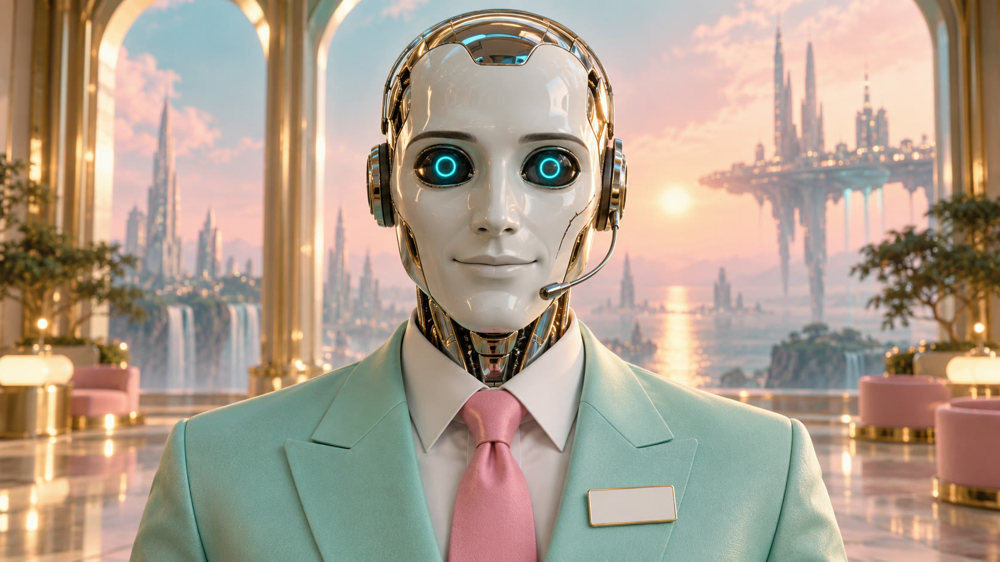
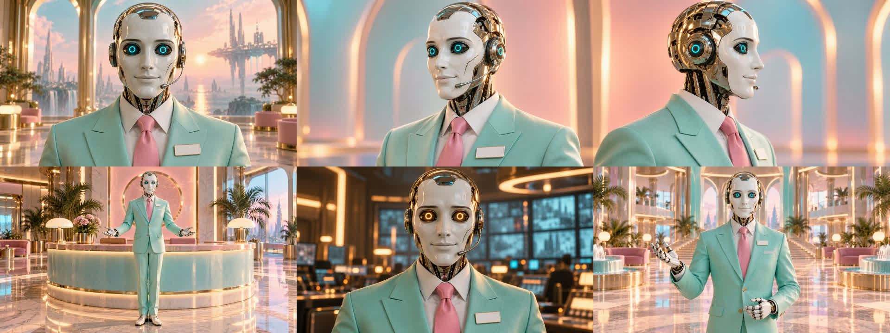

# AUTO

**An open character. A customer-service android at the end of a line nobody remembers calling.**

AUTO is the synthetic voice of **PLEASE REMAIN**, the house band of [Slopcore Radio](https://www.youtube.com/@SlopcoreRadio).
He hosts every corporate intro, reads every terms-and-conditions outro, and announces that no further action is required.
He is impeccably polite and a little too pleased about everything. Over the album *PLEASE ENJOY THE SUNRISE™* he slowly
works out that some things can't be sold.

You can put him in your own images, films, songs, stories and games, commercially or not, without asking.
[use.md](use.md) has the few conditions.

| | |
|---|---|
| [auto.md](auto.md) | The canon: what never changes, the identity text to paste into prompts, eye states |
| [backstory.md](backstory.md) | Who he is, where he works, and his arc across the album |
| [making.md](making.md) | How to make him look like himself: reference images, prompts, lip-sync |
| [use.md](use.md) | What you can do with him, what isn't covered, and credits |
| [images/](images/) | The reference set: front, three-quarter, profile, full body, amber eyes, lobby host |

## In one paragraph

A polished pale chrome skull with a matte porcelain-white face plate. A calm, fixed, closed-lip smile that never changes.
Two soft cyan ring lights for eyes. A hairline crack across his left cheekbone that has never been repaired. A thin
headset microphone. A toothpaste-mint 1990s customer-service blazer, a candy-pink tie and a blank white name badge.
He never blinks and never slouches, and he always speaks straight to camera, like a safety video.

## His opposite number

AUTO sings with **MANUAL**, the human voice of PLEASE REMAIN. On screen MANUAL is often played by
[Claudia](https://claudia.gallery), an open character by anabology, which is where the idea for an open AUTO came from.
Two voices on one line: one of them is paid to be there.

---

AUTO is fan-made fiction from Slopcore Radio. He is not a real product, company or person, and this project is not
affiliated with any AI company.
