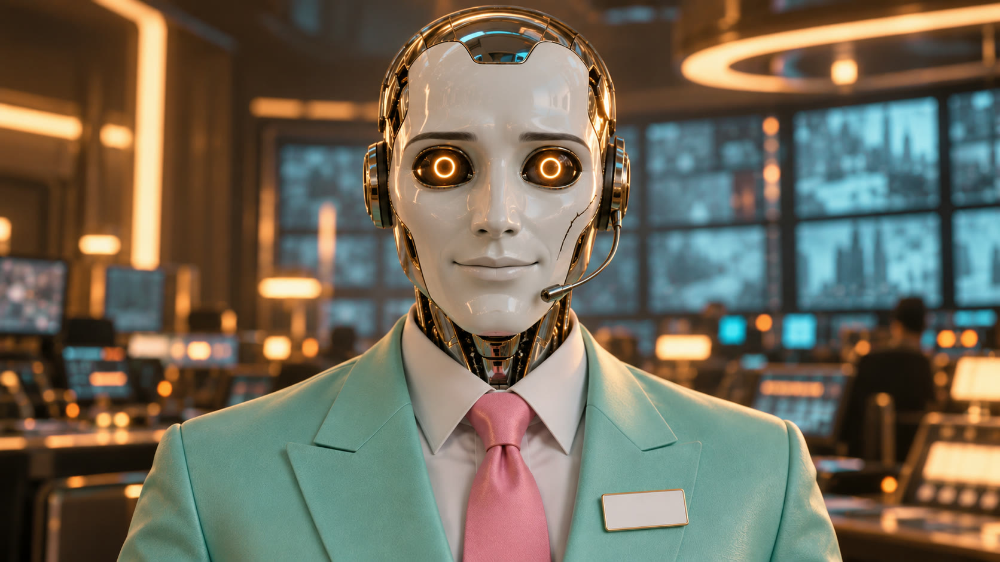

# AUTO: the canon

If an image has all of these, it's AUTO. If one is missing, it's a different android.

## Never changes

- **Head:** a polished pale chrome skull with a matte porcelain-white face plate, an adult man in his late thirties
  in proportion. No human skin anywhere.
- **Smile:** calm, fixed, courteous and closed-lipped. It never moves. When he talks or sings, only the jaw hinges.
- **Eyes:** two soft ring lights in dark glass. They are his only expression (see below).
- **The crack:** a thin hairline crack across his **left** cheekbone. Always there, never repaired.
- **Headset:** a thin headset microphone at his cheek.
- **Uniform:** a pastel 1990s customer-service uniform: toothpaste-mint blazer, candy-pink tie, white shirt, and a
  **blank** white name badge on the left lapel. No writing on the badge, ever.
- **Posture:** upright, hands open in welcome or clasped at the waist. He never slouches and never blinks.

## Eye states

| Colour | Meaning | When |
|---|---|---|
| Cyan | Normal service | Almost always |
| Amber | Uncertain: something doesn't fit the script | Rarely, and he won't mention it |
| White | Sincere | Once. Save it |

## Identity text

Paste this into any image or video prompt:

> AUTO, a customer-service android: a polished pale chrome skull with a matte porcelain-white face plate, adult man in
> his late thirties in proportion, a calm fixed courteous closed-lip smile, two soft cyan ring lights for eyes in dark
> glass, a thin hairline crack across his left cheekbone, a thin headset microphone at his cheek, wearing a pastel 1990s
> customer-service uniform: toothpaste-mint blazer, candy-pink tie, white shirt, a blank white name badge on the left lapel.

Useful things to avoid: *human skin, a human face, visible text on the badge, a moving or open-mouthed smile.*

## Can change

Where he is, the light, the camera, and what he's holding. He can stand at a reception desk, in a control room, at a
press conference podium, or in your kitchen holding a clipboard. The uniform stays.

## Palette and world

Candy pink, toothpaste mint, electric cyan, chrome and warm luxury gold. His natural habitat is a vast pastel 1990s
corporate lobby with potted palms and marble floors, shot like a prestige science-fiction film and played completely
straight.

## Voice

Deadpan, warm, slightly too pleased. Male. His lines are corporate:

- "Good evening, valued human."
- "No further action is required."
- "Your call is important to us."
- "Thank you for staying human."
- "Please remain."
