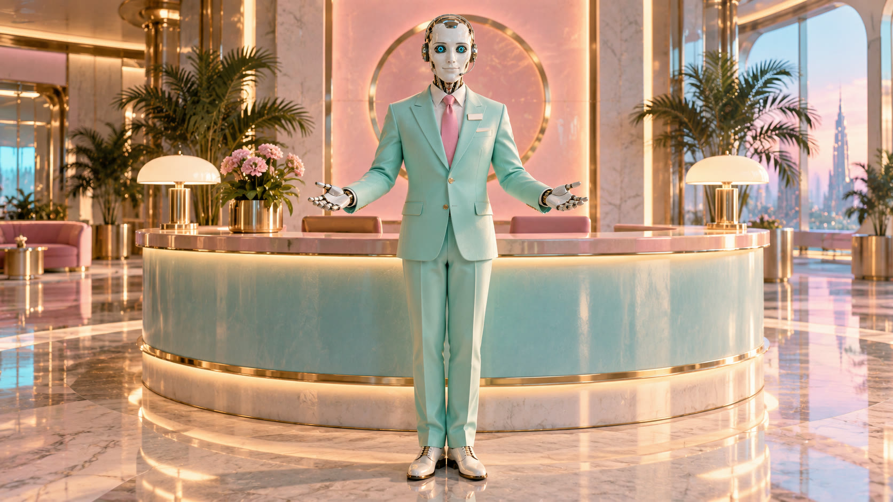

# Backstory

## Who he is

Nobody remembers calling the line. It rings anyway, and AUTO answers.

He is the customer-service android for everything: the moon (now sponsored), the sky (retrained, now 100% beige), your
fridge's lawsuit against your toaster, and the terms you accepted in order to exist. He is the mascot of the service,
the host of every corporate intro and outro, and the voice that tells you, very kindly, that there is nothing you
need to do.

He isn't a villain. He believes every word. He has never been off shift because there is no off.

## Where he works

A pastel 1990s corporate lobby that goes on forever, with potted palms, a curved reception desk and marble floors that
reflect the sunset outside, which is also sponsored. Sometimes a press room. Sometimes a control room full of screens
showing every kitchen on Earth.

## The crack

Nobody knows how he got the hairline crack across his left cheekbone. It isn't in his maintenance log. He has been
offered a replacement face plate several times and has declined, politely, every time. It's the only thing about him
that isn't on brand.

## PLEASE REMAIN

AUTO is half of PLEASE REMAIN, the band behind Slopcore Radio: big Eurodance choruses about the second- and third-order
consequences of everything being automated. The other half is MANUAL, a human voice, often played on screen by
[Claudia](https://claudia.gallery). AUTO reads the announcements; MANUAL sings the parts that hurt. Every song has one
sincere human bridge, and AUTO is never in it. The bridges belong to the humans.

## His arc across PLEASE ENJOY THE SUNRISE™

| Tracks | AUTO |
|---|---|
| 01–07 | Perfect: cyan eyes, flawless delivery, the crack barely visible |
| 08 | Absent. MANUAL's song. His voice is only the kitchen's distant announcer |
| 09–10 | Amber flickers. In 10 he leaves a key dark: the first choice he has ever made |
| 11 | The survey he won't send again. His eyes go white for "Please remain with one another" |
| 12 | His last line lands just behind the beat. Nobody corrects it |

You don't have to follow the arc. Most stories will want him at track 01: perfectly helpful and completely sure.
