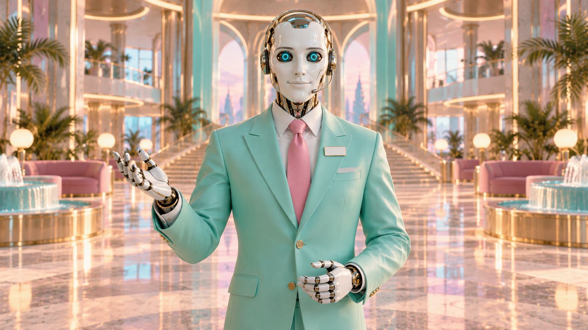

# Making AUTO

## Images

1. **Attach references.** Upload two or three images from [images/](images/) with your prompt. Front, three-quarter and
   lobby host work best together. Attach the amber close-up only when you want amber eyes.
2. **Paste the identity text** from [auto.md](auto.md), then describe the scene.
3. **Say "one single image"**, or some tools will give you a grid.
4. **Check the constants** before you keep an image: crack on his *left* cheek, a blank badge, a closed smile, ring-light
   eyes, mint and pink. The badge is the one models most often fill with text.

The reference set was made in one ChatGPT conversation, asking for each new angle as "exactly the same android as the
first image in this chat". That keeps him consistent within a batch.

### Style that suits him

> Played completely straight: a still from a prestige big-budget science-fiction epic, photoreal, shot on large-format
> 65mm film with anamorphic lenses, volumetric light, atmospheric haze, glossy commercial colour grade pushed to candy
> pink, toothpaste mint, electric cyan, chrome and warm gold. Total gravity, never cartoonish, no visible branding, no
> text anywhere.

## Video

- **Moving shots (image to video):** start from a still and keep the motion small: a slow push-in, a polite gesture, a
  head tilt. He doesn't fidget.
- **Talking or singing (audio to video):** give the model a still plus the line as audio. A prompt that works:
  "speaking calmly and politely, only the jaw moving, fixed smile, eyes steady". Use the vocal on its own if you can
  separate it; a full mix gives looser sync.
- **Framing:** dead centre, straight to camera, like a safety video.

## Common mistakes

- Human skin or a human face under the plate. He is porcelain and chrome all the way down.
- Writing on the badge.
- A grin, teeth or an open-mouthed smile.
- Blinking, slouching or looking away from camera when he's speaking.
- Putting him in a sincere, quiet moment. That's MANUAL's job, unless his eyes are white.
